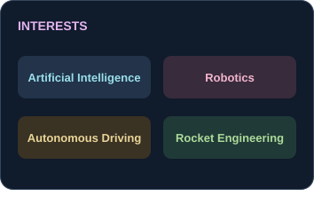

<h1> Park Dongmyung</h1>

<strong>AI Engineer</strong>

Learning and building toward the future I imagine.

<a href="https://park-dongmyung.com/"><picture><source media="(max-width: 1000px)" srcset="assets/links/portfolio.svg" width="110" height="44" /></picture></a>
<a href="https://github.com/Dongmyung378"><picture><source media="(max-width: 1000px)" srcset="assets/links/github.svg" width="110" height="44" /></picture></a>
<a href="https://www.linkedin.com/in/dongmyung-park-192b99412/"><picture><source media="(max-width: 1000px)" srcset="assets/links/linkedin.svg" width="110" height="44" /></picture></a>
<a href="mailto:dongmyungpark378@gmail.com"><picture><source media="(max-width: 1000px)" srcset="assets/links/email.svg" width="110" height="44" /></picture></a>
<a href="https://atcoder.jp/users/ParkDM"><picture><source media="(max-width: 1000px)" srcset="assets/links/atcoder.svg" width="110" height="44" /></picture></a>
<a href="https://leetcode.com/u/Dongmyung/"><picture><source media="(max-width: 1000px)" srcset="assets/links/leetcode.svg" width="110" height="44" /></picture></a>

<picture><source media="(max-width: 480px)" srcset="assets/education.svg" width="100%" /><source media="(max-width: 1000px)" srcset="assets/education-tablet.svg" width="100%" /></picture>
<picture><source media="(max-width: 480px)" srcset="assets/interests-mobile.svg" width="100%" /><source media="(max-width: 1000px)" srcset="assets/interests-tablet.svg" width="100%" /></picture>

<h3>Tech Stack</h3>

<!-- coding-stats:start -->
<h3>Coding Practice</h3>

<a href="https://atcoder.jp/users/ParkDM"><picture><source media="(max-width: 480px)" srcset="https://raw.githubusercontent.com/Dongmyung378/Dongmyung378/main/assets/stats/atcoder.svg?v=20261020T011021Z" width="100%" /><source media="(max-width: 1000px)" srcset="https://raw.githubusercontent.com/Dongmyung378/Dongmyung378/main/assets/stats/atcoder-tablet.svg?v=20261020T011021Z" width="100%" /></picture></a>
<a href="https://leetcode.com/u/Dongmyung/"><picture><source media="(max-width: 480px)" srcset="https://raw.githubusercontent.com/Dongmyung378/Dongmyung378/main/assets/stats/leetcode.svg?v=20261020T011021Z" width="100%" /><source media="(max-width: 1000px)" srcset="https://raw.githubusercontent.com/Dongmyung378/Dongmyung378/main/assets/stats/leetcode-tablet.svg?v=20261020T011021Z" width="100%" /></picture></a>

Open a card to view the latest official profile. Scheduled daily at 00:00 UTC. Cards show the last successful refresh (UTC).

<!-- coding-stats:end -->

