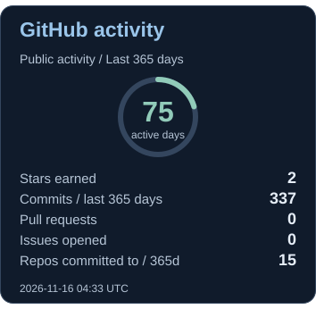
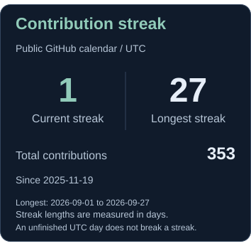
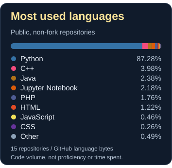
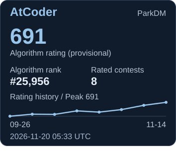
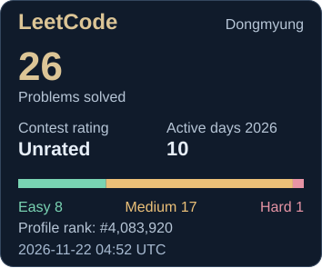

<picture>
  <source media="(max-width: 480px)" srcset="assets/header-mobile.svg?v=pastel2" />
  <source media="(max-width: 1000px)" srcset="assets/header-tablet.svg?v=pastel2" />
  
</picture>

<a href="https://park-dongmyung.com/"><picture><source media="(max-width: 1000px)" srcset="assets/links/portfolio.svg?v=pastel2" width="104" height="42" /></picture></a>
<a href="https://github.com/Dongmyung378"><picture><source media="(max-width: 1000px)" srcset="assets/links/github.svg?v=pastel2" width="104" height="42" /></picture></a>
<a href="https://www.linkedin.com/in/dongmyung-park-192b99412/"><picture><source media="(max-width: 1000px)" srcset="assets/links/linkedin.svg?v=pastel2" width="104" height="42" /></picture></a>
<a href="mailto:dongmyungpark378@gmail.com"><picture><source media="(max-width: 1000px)" srcset="assets/links/email.svg?v=pastel2" width="104" height="42" /></picture></a>
<a href="https://atcoder.jp/users/ParkDM"><picture><source media="(max-width: 1000px)" srcset="assets/links/atcoder.svg?v=pastel2" width="104" height="42" /></picture></a>
<a href="https://leetcode.com/u/Dongmyung/"><picture><source media="(max-width: 1000px)" srcset="assets/links/leetcode.svg?v=pastel2" width="104" height="42" /></picture></a>

<picture><source media="(max-width: 480px)" srcset="assets/education.svg?v=pastel2" width="100%" /><source media="(max-width: 1000px)" srcset="assets/education-tablet.svg?v=pastel2" width="100%" /></picture>
<picture><source media="(max-width: 480px)" srcset="assets/interests-mobile.svg?v=pastel2" width="100%" /><source media="(max-width: 1000px)" srcset="assets/interests-tablet.svg?v=pastel2" width="100%" /></picture>

<h2>Tech Stack</h2>

<!-- github-stats:start -->
<h2>GitHub Stats</h2>

<a href="https://github.com/Dongmyung378?tab=overview"><picture><source media="(max-width: 480px)" srcset="https://raw.githubusercontent.com/Dongmyung378/Dongmyung378/main/assets/stats/github-overview-card.svg?v=20261128T060548Z-pastel2" width="100%" /><source media="(max-width: 1000px)" srcset="https://raw.githubusercontent.com/Dongmyung378/Dongmyung378/main/assets/stats/github-overview.svg?v=20261128T060548Z-pastel2" width="100%" /></picture></a>
<a href="https://github.com/Dongmyung378?tab=overview"><picture><source media="(max-width: 480px)" srcset="https://raw.githubusercontent.com/Dongmyung378/Dongmyung378/main/assets/stats/github-streak.svg?v=20261128T060548Z-pastel2" width="100%" /><source media="(max-width: 1000px)" srcset="https://raw.githubusercontent.com/Dongmyung378/Dongmyung378/main/assets/stats/github-streak-tablet.svg?v=20261128T060548Z-pastel2" width="100%" /></picture></a>
<a href="https://github.com/Dongmyung378?tab=repositories"><picture><source media="(max-width: 480px)" srcset="https://raw.githubusercontent.com/Dongmyung378/Dongmyung378/main/assets/stats/github-languages.svg?v=20261128T060548Z-pastel2" width="100%" /><source media="(max-width: 1000px)" srcset="https://raw.githubusercontent.com/Dongmyung378/Dongmyung378/main/assets/stats/github-languages-tablet.svg?v=20261128T060548Z-pastel2" width="100%" /></picture></a>

Official GitHub data / Daily at 00:00 UTC / Last successful refresh shown. <a href="docs/profile-statistics.md">How the statistics are counted</a>

<!-- github-stats:end -->

<!-- coding-stats:start -->
<h2>Coding Practice</h2>

<a href="https://atcoder.jp/users/ParkDM"><picture><source media="(max-width: 480px)" srcset="https://raw.githubusercontent.com/Dongmyung378/Dongmyung378/main/assets/stats/atcoder.svg?v=20261128T060548Z-pastel2" width="100%" /><source media="(max-width: 1000px)" srcset="https://raw.githubusercontent.com/Dongmyung378/Dongmyung378/main/assets/stats/atcoder-tablet.svg?v=20261128T060548Z-pastel2" width="100%" /></picture></a>
<a href="https://leetcode.com/u/Dongmyung/"><picture><source media="(max-width: 480px)" srcset="https://raw.githubusercontent.com/Dongmyung378/Dongmyung378/main/assets/stats/leetcode.svg?v=20261128T060548Z-pastel2" width="100%" /><source media="(max-width: 1000px)" srcset="https://raw.githubusercontent.com/Dongmyung378/Dongmyung378/main/assets/stats/leetcode-tablet.svg?v=20261128T060548Z-pastel2" width="100%" /></picture></a>

Open a card for the official profile / Daily at 00:00 UTC / Last successful refresh shown.

<!-- coding-stats:end -->

