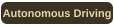

<h1>Park Dongmyung</h1>

<strong>AI Engineer</strong> 
Learning and building toward the future I imagine.

 

<h3>Education</h3>

  <strong>University of Manchester</strong> 
  BSc Artificial Intelligence 
  First Class Honours 
  September 2021 – July 2026

<h3>Interests</h3>

  
  
   
  
  

<h3>Tech Stack</h3>

  
  
  
  
  

  
  
  
  
  

