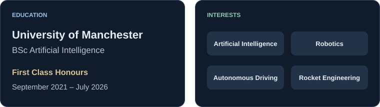

<h1>Park Dongmyung</h1>

<strong>AI Engineer</strong> &nbsp; 

Learning and building toward the future I imagine.

<picture>
  <source media="(max-width: 480px)" srcset="assets/overview-mobile.svg" />
  <source media="(max-width: 700px)" srcset="assets/overview-tablet.svg" />
  
</picture>

<h3>Tech Stack</h3>

